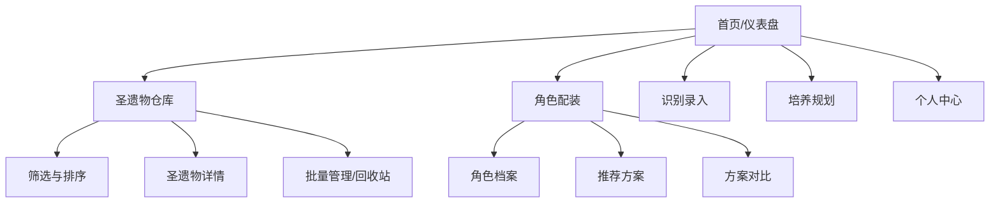

# 原神圣遗物管理工具（Web + 微信小程序）产品需求文档

| 项目 | 内容 |
| --- | --- |
| 产品代号 | 圣遗物仓库（暂定） |
| 文档版本 | v1.0 |
| 状态 | 可进入技术方案与排期评审 |
| 目标平台 | Web、微信小程序 |
| 首发范围 | 个人圣遗物管理、录入、筛选、角色配装推荐 |

## 1. 背景与机会

《原神》玩家会长期积累大量圣遗物，但游戏内的筛选、横向比较和角色适配判断成本较高。用户尤其容易遇到三类问题：

1. 不确定新获得的圣遗物是否值得锁定或强化；
2. 很难从大量库存中找到最适合某个角色的五件装备；
3. 缺少对培养缺口、待强化胚子和可处理库存的统一管理。

产品定位为**个人圣遗物资产管理与辅助决策工具**。它帮助用户整理、检索和比较自己的库存；不读取游戏账号、不自动化操作游戏、不提供违规脚本。

## 2. 目标、非目标与成功指标

### 2.1 产品目标

- 让用户在 1 分钟内完成一件圣遗物的录入或确认。
- 让用户在库存中快速定位符合条件的圣遗物。
- 为指定角色提供可解释、可调整的配装推荐。
- 保证同一账户在 Web 与微信小程序间的数据一致。

### 2.2 MVP 非目标

- 不接入用户游戏账号、密码或 Cookie。
- 不实现自动刷本、强化、分解、登录等游戏自动化能力。
- 不做全角色、全队伍、逐帧伤害的精确模拟器。
- 不在 MVP 建设社区、交易、账号估价、排行榜等功能。

### 2.3 首发成功指标（上线后 8 周观察）

| 指标 | 目标 |
| --- | --- |
| 新用户完成首件录入率 | ≥ 60% |
| 已登录用户 7 日留存 | ≥ 20% |
| 人均入库圣遗物数 | ≥ 50 件 |
| 推荐方案查看后应用率 | ≥ 25% |
| OCR 确认后字段正确率 | ≥ 90% |
| 仓库筛选 P95 响应时间 | < 1 秒 |

## 3. 用户与使用场景

| 用户 | 痛点 | 核心场景 |
| --- | --- | --- |
| 轻度养成玩家 | 害怕误分解有潜力的胚子 | 获得新圣遗物后判断保留价值 |
| 深渊/强度玩家 | 库存多、配装组合复杂 | 为目标角色寻找最优套装和词条 |
| 多角色培养玩家 | 不清楚培养缺口 | 管理待强化圣遗物、补齐套装部位 |
| 内容分享用户 | 需要清晰展示角色配置 | 生成角色配装卡片并分享 |

## 4. 产品原则

- **结果可解释**：评分和推荐必须展示原因，不能只给“最优”结论。
- **用户可控**：识别结果可修改；角色流派和权重可逐步开放自定义。
- **先准确后自动化**：手动录入是完整闭环，OCR 仅加速而不替代确认。
- **跨端一致**：数据模型、规则和核心操作在 Web 与小程序一致。
- **合规优先**：不触碰账号凭据及游戏自动化。

## 5. 信息架构



## 6. 功能需求

### 6.1 P0：账号与跨端同步

| 编号 | 需求 | 验收标准 |
| --- | --- | --- |
| A-01 | 微信小程序一键登录 | 用户授权后创建或关联账户 |
| A-02 | Web 微信扫码登录 | 扫码确认后 Web 获取同一用户会话 |
| A-03 | 本地草稿与云端同步 | 在任一端新增、编辑圣遗物，另一端刷新后可见 |
| A-04 | 游客数据迁移 | 登录时用户可选择合并本地数据或以云端数据覆盖 |
| A-05 | 数据导出与注销 | 用户可导出个人数据，并发起账号注销 |

### 6.2 P0：圣遗物仓库

#### 6.2.1 数据字段

每件圣遗物必须记录以下信息：

| 字段 | 说明 |
| --- | --- |
| 套装、部位、星级 | 基础标识；部位为花、羽、沙、杯、冠 |
| 等级 | +0 至 +20 |
| 主词条及数值 | 类型与当前数值 |
| 副词条 | 最多四条，包含类型与数值 |
| 锁定状态 | 已锁定/未锁定 |
| 装备角色 | 可为空；一件装备仅能装备给一名角色 |
| 标签、备注 | 用户自定义，例如“待强化”“毕业候选” |
| 来源与时间 | 可选来源备注、创建及更新时间 |

#### 6.2.2 操作与筛选

- 支持手动新增、编辑、复制、删除、恢复圣遗物。
- 支持按套装、部位、星级、等级、主词条、副词条、是否锁定、是否装备、标签筛选。
- 支持按综合评分、双暴、等级、最近更新排序。
- 支持网格/列表视图和批量修改锁定状态、标签、备注。
- 删除后进入回收站保留 30 天；支持恢复和永久删除。

**验收标准**：在 1,000 件库存内，用户可叠加至少五项筛选条件；筛选结果在 P95 小于 1 秒返回。

### 6.3 P0：手动录入与截图识别

#### 6.3.1 手动录入

- 录入表单根据部位自动限制合法主词条。
- 副词条不允许重复；数值应根据星级、等级、词条字典做合理性校验。
- 用户可保存为草稿，之后补全。

#### 6.3.2 单张截图 OCR

1. 用户从相册选择或拍摄圣遗物详情截图。
2. 系统识别套装、部位、等级、主词条和副词条。
3. 结果进入“待确认”表单，用户可逐项修改。
4. 用户确认后才写入仓库。
5. 图片默认在识别完成后删除；仅在用户主动勾选时保存原图。

**边界**：OCR 无法判断或置信度较低时，不阻止保存，改为突出提示用户核对。MVP 不承诺批量截图识别。

### 6.4 P0：角色档案与手动配装

| 编号 | 需求 | 验收标准 |
| --- | --- | --- |
| C-01 | 创建角色档案 | 选择角色、武器、命座及可选天赋等级 |
| C-02 | 装备圣遗物 | 五个部位各选择一件库存圣遗物 |
| C-03 | 属性汇总 | 汇总主词条、副词条与套装效果；明确展示计算口径 |
| C-04 | 目标属性 | 可设置暴击、暴伤、充能、精通、生命等目标范围 |
| C-05 | 保存方案 | 单角色可保存多个命名方案并设为当前方案 |

### 6.5 P0：评分与配装推荐

#### 6.5.1 规则配置

每个“角色 + 流派”维护一组版本化规则：

- 套装优先级：4 件套、2+2 套或无强制套装。
- 各部位推荐主词条。
- 副词条权重。
- 关键阈值：如元素充能最低需求、暴击率建议区间。
- 不适用属性的惩罚或零权重。

规则首发覆盖 **10～20 个高使用率角色及其主流流派**。游戏数据与规则由运营后台独立更新。

#### 6.5.2 推荐算法（MVP）

1. 按角色流派规则计算每件圣遗物的单件分数。
2. 每个部位选取满足条件的前 N 件候选（建议 N=20）。
3. 在候选集内搜索组合，优先满足套装效果和关键属性阈值。
4. 输出 3～5 个方案：综合最佳、双暴优先、充能/生存优先等。
5. 每套方案显示相对当前方案的变化与评分依据。

**性能约束**：只对 Top N 候选做组合搜索，避免在大库存上直接进行全排列；推荐结果允许缓存，缓存键包含库存更新时间与规则版本。

#### 6.5.3 推荐结论

系统对单件圣遗物给出以下建议之一：

| 结论 | 触发原则 |
| --- | --- |
| 值得锁定 | 主词条正确且命中多个高价值副词条 |
| 值得强化 | 未满级且具备 3～4 条有效副词条 |
| 暂时保留 | 适配范围有限，但存在潜力 |
| 可处理 | 主词条及副词条均无目标流派适配 |
| 毕业候选 | 在用户该角色/部位候选中评分领先 |

结论必须附带命中词条、适配流派和限制条件；禁止将其表述为绝对结论。

### 6.6 P1：培养规划与统计

- 为角色保存目标套装、主词条和关键副词条。
- 自动显示当前缺失部位、库存替代品、待强化候选。
- 首页展示库存总数、待强化数、未锁定高分件、目标角色完成度。
- 提供套装、主词条、等级和角色占用情况的基础统计。

### 6.7 P1：分享

- 生成角色配装卡片，包含角色、武器、套装、五件圣遗物和属性摘要。
- 小程序支持转发卡片；Web 支持图片下载和只读链接。
- 分享内容由用户选择，默认不公开库存总量、账号标识和备注。

## 7. 页面需求

| 页面 | 关键模块 | 平台差异 |
| --- | --- | --- |
| 首页 | 录入入口、待处理、目标角色、库存概览 | 小程序突出快捷入口；Web 突出统计 |
| 仓库 | 筛选器、圣遗物卡片、批量工具栏 | Web 支持更宽的组合筛选；小程序使用筛选抽屉 |
| 圣遗物详情 | 属性、评分、适配角色、编辑、删除 | 两端功能一致 |
| 录入确认 | 图片预览、识别字段、校验提示、保存 | 小程序优先相机/相册入口 |
| 角色详情 | 当前配装、目标属性、推荐入口、已存方案 | Web 增加方案横向对比 |
| 推荐结果 | 推荐方案、属性变化、评分说明、应用方案 | 两端功能一致 |
| 个人中心 | 同步状态、导出、隐私、注销 | Web 增加扫码登录管理 |

## 8. 数据与接口设计

### 8.1 核心实体

```text
User(id, wechat_union_id, nickname, settings)
Artifact(id, user_id, set_id, slot, rarity, level,
         main_stat_type, main_stat_value, sub_stats_json,
         locked, equipped_character_build_id, tags, note, timestamps)
CharacterBuild(id, user_id, character_id, weapon_id, constellation,
               talent_levels_json, build_type, target_stats_json, timestamps)
BuildPlan(id, character_build_id, name, artifact_ids_json, is_current)
BuildRule(id, game_version, character_id, build_type, preferred_sets_json,
          main_stat_rules_json, sub_stat_weights_json, constraints_json, version)
GameData(id, game_version, data_type, payload_json, published_at)
```

### 8.2 API 原则

- 使用 REST API；前端以 OpenAPI 文档生成类型和客户端。
- 所有用户资源按 `user_id` 强制隔离，服务端不得接受任意用户 ID 作为授权依据。
- 列表接口支持游标分页、组合筛选和排序白名单。
- 更新接口采用 `updated_at` 或版本号进行乐观锁，降低双端编辑冲突。
- OCR 任务采用异步任务接口：提交图片、轮询/订阅结果、用户确认入库。

## 9. 技术方案与可实现性

| 层级 | 推荐技术 | 说明 |
| --- | --- | --- |
| Web | React + Next.js + TypeScript | 适合复杂筛选、分享页和运营后台 |
| 小程序 | Taro + React + TypeScript | 复用业务模型与部分 UI 逻辑 |
| 服务端 | NestJS + TypeScript | 统一 API、鉴权、任务与规则服务 |
| 数据库 | PostgreSQL | JSON 字段配合关系查询，适合规则及装备数据 |
| 缓存/队列 | Redis + BullMQ | OCR 异步任务、推荐缓存、限流 |
| 文件存储 | COS/OSS/S3 兼容对象存储 | 临时存放 OCR 图片、生成分享图 |
| OCR | 云 OCR 服务 + 自建文本解析器 | 首发可快速上线；结果必须人工确认 |
| 后台 | Next.js 管理后台 | 管理游戏资料、规则版本、识别异常 |

### 9.1 关键实现约束

- 游戏静态数据、角色规则、用户库存必须分库逻辑隔离并可独立版本更新。
- OCR 识别的结构化字段必须经过词条字典和合法性校验。
- 推荐采用规则引擎与有限候选组合搜索；不依赖大模型实时输出配装结论。
- 图片上传应限格式、尺寸、频率；处理完成后自动清理未被用户保留的原图。
- 微信登录、隐私政策、用户数据导出/删除能力应在上线前完成。

## 10. 非功能需求

| 类别 | 要求 |
| --- | --- |
| 性能 | 常规筛选 P95 < 1 秒；单张 OCR 目标 3～8 秒；推荐计算目标 < 5 秒 |
| 容量 | 单用户至少支持 3,000 件圣遗物、100 个角色方案 |
| 可用性 | 核心 API 月可用性目标 99.5% |
| 安全 | HTTPS、鉴权、限流、敏感配置不下发客户端、上传文件校验 |
| 隐私 | 最小化收集数据；默认不保存 OCR 原图；支持导出与注销 |
| 兼容 | Web 覆盖现代 Chrome、Edge、Safari；小程序覆盖近两年主流微信版本 |

## 11. 风险与应对

| 风险 | 影响 | 应对 |
| --- | --- | --- |
| OCR 误识别 | 导致库存数据错误 | 强制确认页、置信度提示、可手动编辑 |
| 游戏版本更新 | 新角色/套装规则滞后 | 静态数据和规则后台版本化管理 |
| 推荐不符合个人偏好 | 用户不信任结论 | 展示评分依据；P1 支持自定义权重 |
| 大库存计算慢 | 配装推荐延迟 | Top N 候选截断、缓存、异步计算 |
| 用户误删除 | 数据损失 | 回收站、批量操作二次确认、恢复能力 |
| 合规风险 | 平台或用户投诉 | 不采集游戏凭据；不提供自动化操作；明确非官方工具 |

## 12. 上线验收标准

1. 用户可在 Web 和小程序完成登录，并看到同一份库存。
2. 用户可手动新增、编辑、删除和恢复一件圣遗物。
3. 用户可在 1,000 件库存内组合筛选至少五个条件。
4. 用户可提交一张截图，修正 OCR 结果后保存为完整圣遗物。
5. 用户可给角色装备五件圣遗物，并查看套装和属性汇总。
6. 已覆盖的角色流派可输出至少三套不重复、无装备冲突的推荐方案。
7. 每项评分与推荐均展示规则版本和主要原因。
8. 用户可导出自己的数据，并在个人中心提交账号注销。

---

# 开发计划

## 1. 团队配置

| 角色 | 建议投入 | 主要职责 |
| --- | --- | --- |
| 产品经理 | 1 人 | 需求细化、规则验收、版本节奏、数据口径 |
| UI/UX 设计师 | 1 人（前 4～6 周） | 双端设计系统、关键流程、可用性测试 |
| 前端工程师 | 1～2 人 | Web、管理后台、共享业务组件 |
| 小程序工程师 | 1 人 | 小程序页面、微信能力、离线缓存 |
| 后端工程师 | 1～2 人 | API、数据模型、鉴权、推荐、OCR 任务 |
| 测试工程师 | 1 人（第 5 周起） | 功能、兼容、回归、性能和验收 |
| 运营/游戏规则维护 | 0.5 人 | 游戏数据、角色流派规则与内容配置 |

## 2. 推荐排期（10 周 MVP）

| 阶段 | 周期 | 主要工作 | 可交付结果 |
| --- | --- | --- | --- |
| 0. 立项与澄清 | 第 1 周 | 原型、数据字典、首批角色清单、技术选型、埋点方案 | 评审通过的 PRD、原型、接口草案 |
| 1. 基础设施 | 第 2 周 | 仓库、CI/CD、数据库、登录、环境、设计系统 | 可部署的空壳应用、鉴权链路 |
| 2. 仓库核心 | 第 3～4 周 | 圣遗物 CRUD、筛选排序、批量操作、同步、回收站 | Web/小程序可管理库存 |
| 3. OCR 与角色档案 | 第 5～6 周 | 单图识别、确认页、角色档案、手动配装、属性汇总 | 可完成录入和基础配装 |
| 4. 推荐与后台 | 第 7～8 周 | 评分规则、组合推荐、规则后台、首批角色配置 | 可解释的推荐方案 |
| 5. 联调与测试 | 第 9 周 | 全链路测试、性能优化、异常处理、隐私与导出 | 发布候选版本 RC |
| 6. 灰度发布 | 第 10 周 | 小范围用户测试、修复阻断问题、数据监控 | MVP 正式发布 |

## 3. 关键里程碑

| 里程碑 | 时间 | 达成定义 |
| --- | --- | --- |
| M1：数据闭环 | 第 4 周末 | 用户可跨端创建、筛选、编辑、恢复库存 |
| M2：录入闭环 | 第 6 周末 | 手动与单图 OCR 确认录入均可用 |
| M3：决策闭环 | 第 8 周末 | 首批角色可获得并应用推荐方案 |
| M4：发布就绪 | 第 9 周末 | P0 用例通过、无 P0/P1 缺陷、完成隐私与性能检查 |
| M5：正式发布 | 第 10 周末 | 完成灰度验证并发布双端版本 |

## 4. 分阶段任务拆分

### 第 1 周：需求与设计冻结

- 确认首批支持的角色、流派和套装范围。
- 建立圣遗物、词条、角色和规则的静态数据字典。
- 完成仓库、录入、角色详情、推荐结果四个核心页面高保真原型。
- 确认 OCR 服务成本、准确率样本和降级策略。
- 确认隐私政策、用户协议和“非官方工具”声明。

### 第 2～4 周：最小数据闭环

- 实现微信登录与 Web 扫码登录。
- 完成数据库迁移、用户隔离、审计日志与基础监控。
- 完成仓库列表、筛选、详情、手动录入、编辑、批量操作和回收站。
- 完成 Web/小程序云端同步与冲突处理。
- 完成基础单元测试与接口测试。

### 第 5～6 周：录入与配装闭环

- 接入图片上传、异步 OCR 任务、识别确认与错误兜底。
- 实现角色档案、库存选择、五件装备槽位和属性汇总。
- 完成首批静态游戏数据导入及后台维护页面。
- 使用真实截图样本测试识别质量，建立人工修正规则。

### 第 7～8 周：推荐闭环

- 实现规则驱动的单件评分与组合搜索。
- 配置首批 10～20 个角色的主流流派规则。
- 实现推荐结果、评分依据、当前方案对比和应用方案。
- 对 1,000/3,000 件库存做性能压测与缓存优化。

### 第 9～10 周：质量与发布

- 完成 P0/P1 功能回归、微信真机兼容和 Web 主流浏览器测试。
- 完成安全检查、限流、异常告警、备份恢复演练。
- 建立核心漏斗、OCR 纠错、推荐采纳、留存等数据看板。
- 组织 30～100 名种子用户灰度，修复阻断问题后发布。

## 5. 上线后两期迭代

| 版本 | 建议周期 | 重点 |
| --- | --- | --- |
| V1.1 | 上线后 4～6 周 | 批量 OCR、培养规划、统计、分享卡片、自定义权重 |
| V2.0 | 上线后 8～12 周 | 队伍维度配装协调、目标面板缺口、更多导入方式与规则社区 |

## 6. 开发前必须确认的决策

1. 首发角色与流派的具体清单，以及规则维护责任人。
2. OCR 供应商、单次成本上限、原图保存策略和识别失败降级路径。
3. Web 与小程序是否共用 Taro；如 Web 需要更强 SEO/分享能力，建议采用 Next.js + Taro 小程序的双前端模式。
4. 是否在 MVP 支持游客模式；若支持，需明确合并冲突规则。
5. 是否需要面向开发团队的运营后台与游戏数据发布审核流；建议 MVP 即建设最小版本。
