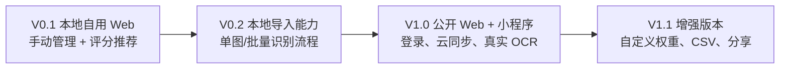
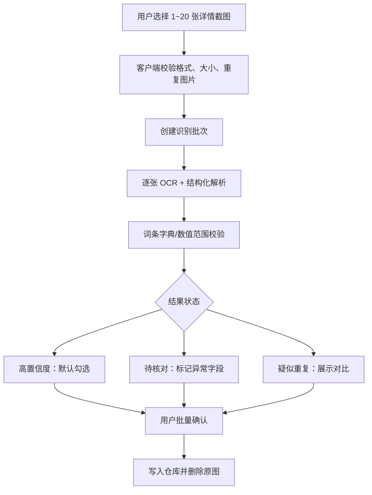
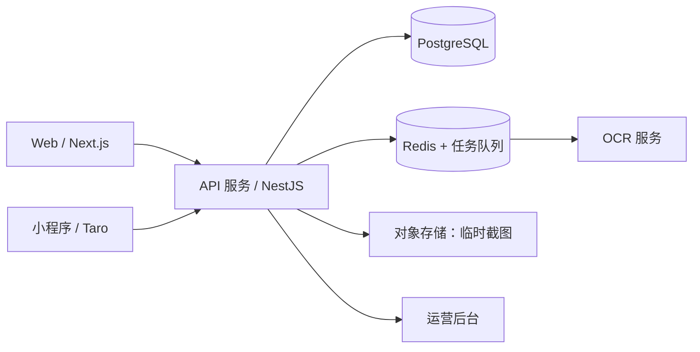

# 《圣遗物管理大师》详细开发计划

## 0. 2026-07-31 实施更新

- 本地 Windows 版已完成第二轮界面重构：采用“星穹典藏”深海军蓝、星图、暗金档案视觉，并使用原创、可本地替换的角色和圣遗物素材。
- 已补齐手动录入副词条、OCR 入库前名称/主词条校验、库存排序、锁定/强化队列/回收站/JSON 导入导出、本地素材替换和响应式移动导航。
- 已完成生产构建、静态检查、Edge Chromium 桌面/移动端运行时检查及 Windows EXE 启动检查；视觉 QA 报告见 `design-qa.md`。
- 已新增 Windows 本地“实时录入助手”：用户明确选择可见窗口/屏幕后，在内存内截图与 OCR；自动检测到详情页或主动按 `F8` 后进入最多 20 件的待确认批次。该能力不读取游戏进程、内存、网络或账号信息，不发送输入事件。
- 已完成本地批量截图 OCR：一次选择 1～20 张截图、复用一个本地 OCR 工作进程、逐张进入统一待确认批次，并且不会静默入库。
- 仍属于 V0.1 本地自用版：微信登录/云同步、小程序原生工程、后台规则维护和公开发布合规材料仍按后续阶段推进。

## 当前交付状态（本地自用版）

截至 2026-07-27，已完成可在 Windows 双击启动的本地版交付：

- 已实现：本地 IndexedDB 数据保存、手动录入/编辑、搜索和基础筛选、锁定、强化队列、回收站、JSON 导入导出、10 个角色的预设评分与库存推荐、单张/批量（最多 20 张）截图本地 OCR 及人工确认入库。
- 已实现：深蓝古金“星穹典藏”仓库界面；角色头像与圣遗物图标由用户在“本地素材”中自行导入，文件不会上传，也不会打包任何官方素材。
- 已验证：生产构建成功；Windows 便携程序可启动；仓库页和手动录入弹窗在浏览器中可正常加载，控制台无应用错误。
- 后续公开版前置：Web/小程序登录、云同步、运营后台和正式发布，仍需要产品方提供小程序 AppID、已备案 HTTPS 域名、云资源及 OCR 服务账号。

本地版程序入口：`apps/web/release/圣遗物管理大师-win32-x64/圣遗物管理大师.exe`。

### 已落地技术决策（以实现为准）

为让本地版可以无服务运行并交付 Windows 双击程序，首版实际采用 **Vite + React + TypeScript + CSS Variables + IndexedDB（idb-keyval）+ Electron 便携壳**。这替代了原计划中仅作为公开版候选的 Next.js、Zustand、Dexie 等方案；评分规则目前位于前端版本化代码中，公开版再迁移为可在后台维护的规则包。

---

| 项目 | 结论 |
| --- | --- |
| 产品名称 | 圣遗物管理大师 |
| 当前策略 | 先完成本地自用版，再发布 Web + 微信小程序公开版 |
| 首发语言 | 简体中文；数据模型预留多语言字段 |
| 核心范围 | 圣遗物管理、手动/截图导入、角色配装推荐、强化胚子判断 |
| 界面方向 | 星穹典藏：深海军蓝、星图、古金色、原创典藏档案视觉 |
| 数据边界 | 不读取游戏客户端、账号、UID、Cookie、Token、进程或网络数据 |
| 商业模式 | 首期完全免费 |

---

## 1. 已确认的需求基线

### 1.1 用户与发布策略

1. 第一阶段为个人本地自用，验证核心流程和评分规则。
2. 第二阶段面向公开玩家发布。
3. Web 与微信小程序最终功能对等；本地自用阶段优先完成响应式 Web。
4. 公开版使用微信小程序登录、Web 微信扫码登录，并提供本地游客模式。

### 1.2 功能范围

- 手动录入圣遗物。
- 单张截图 OCR 识别。
- 每批最多 20 张详情截图的批量 OCR 识别。
- 所有 OCR 结果先进入确认页；高置信度条目可一键勾选保存，但绝不静默入库。
- 圣遗物仓库、筛选、排序、锁定、标签、回收站。
- 角色档案与当前库存最佳配装推荐。
- “值得强化的胚子”判断与评分原因说明。
- 首发覆盖 10 个热门角色，每个角色配置 1～2 种主流流派。
- 只统计圣遗物带来的属性贡献；不做完整角色面板与伤害模拟。
- MVP 使用预设评分规则；自定义权重放在 V1.1。
- JSON 导出、账号注销；CSV 导出放在 V1.1。
- 最小运营后台：游戏静态数据、角色流派、词条权重、规则版本管理。

### 1.3 数据、隐私与合规原则

- 本地自用版默认以浏览器 IndexedDB 保存数据；不需要账号和服务器。
- 公开版云端同步采用 HTTPS、账户隔离、最小化数据收集及可导出/注销设计。
- OCR 原图只用于识别，任务完成后立即删除；不设默认长期图片存储。
- UID 完全可选且默认隐藏；首期不做角色分享，避免不必要的个人数据。
- 产品显著声明：`非官方工具，与 HoYoverse/米哈游无隶属、授权或合作关系。`
- 界面只使用原创图标、插画和排版；不使用官方 Logo、角色立绘、官方 UI、音效或游戏资源。

---

## 2. 分阶段交付策略



### 阶段 A：V0.1 本地自用版

**目标**：你可在自己的电脑浏览器中管理圣遗物、录入数据、筛选库存、给首批角色获得配装推荐。此版本无需 AppID、域名、云服务器或正式 OCR 服务。

**建议周期**：3～4 周。

**为什么先做 Web**：本地版的重点是验证数据结构、评分规则和核心交互。响应式 Web 可同时验证电脑与手机浏览器布局，之后小程序复用 TypeScript 业务模型和视觉规范，而不是先被小程序资质与服务域名阻塞。

### 阶段 B：V0.2 导入验证版

**目标**：完成截图导入界面、识别任务流程、确认页、字段校验、去重和批量操作；先以可替换的 OCR 适配层接入测试服务或本地方案验证。

**建议周期**：1～2 周。

**说明**：真实稳定的中文游戏截图 OCR 需要选定服务商和账号密钥。代码会先实现统一 OCR 接口与完整确认流程，避免将供应商 SDK 写死在前端。

### 阶段 C：V1.0 公开发布版

**目标**：上线 Web 与微信小程序，提供账户体系、云端同步、正式 OCR、运营后台及基础监控。

**建议周期**：6～8 周（从具备小程序主体、AppID、域名、服务器与 OCR 服务账号开始计算）。

---

## 3. V0.1 详细开发计划（本地自用）

### 3.1 技术方案

| 层级 | 技术选择 | 目的 |
| --- | --- | --- |
| 前端框架 | Next.js + React + TypeScript | 可本地启动，后续可部署 Web 与运营后台 |
| 样式 | Tailwind CSS + CSS Variables | 快速实现并沉淀“星穹典藏”设计令牌 |
| 状态管理 | Zustand | 管理筛选、编辑草稿、仓库状态 |
| 本地数据库 | IndexedDB + Dexie | 存储大量圣遗物，避免 LocalStorage 容量限制 |
| 表单校验 | Zod + React Hook Form | 约束词条、部位和数值合法性 |
| 静态资料 | 版本化 JSON | 套装、词条、首批角色与流派规则 |
| 单元测试 | Vitest | 评分规则、筛选和去重验证 |
| 端到端测试 | Playwright | 录入、筛选、配装推荐主流程 |

### 3.2 目录与模块边界

```text
apps/web/                         # 响应式 Web 前端
packages/core/                    # 圣遗物模型、校验、评分、推荐算法
packages/game-data/               # 游戏静态数据与规则版本
packages/ui/                      # 可复用组件与设计令牌
docs/                             # PRD、开发计划、数据字典
```

**约束**：业务规则、数据模型和算法必须放在 `packages/core`，不能写死在页面组件中；未来小程序使用同一包，从源头减少双端逻辑不一致。

### 3.3 每周任务与交付物

| 周期 | 任务 | 验收产物 |
| --- | --- | --- |
| 第 1 周 | 初始化项目、设计令牌、静态数据字典、数据模型、仓库页面骨架 | 可启动的本地应用；完成主题、导航、空状态与路由 |
| 第 2 周 | 圣遗物 CRUD、手动录入、字段校验、库存列表、筛选排序、详情页 | 可完整录入、编辑、筛选至少 1,000 件本地数据 |
| 第 3 周 | 锁定、标签、批量处理、回收站、导入/导出 JSON、角色档案与手动配装 | 可恢复误删数据；可导出/导入个人仓库 |
| 第 4 周 | 评分规则、强化建议、Top-N 候选组合推荐、方案对比、测试与性能优化 | 首批角色可输出三套无冲突推荐方案；本地验收通过 |

### 3.4 V0.1 功能拆分

#### A. 静态游戏数据与规则

- 建立套装、部位、星级、主词条、副词条的标准枚举。
- 建立词条合法数值范围，用于表单校验和 OCR 结果校验。
- 首批配置 10 个角色与 1～2 个流派/角色；规则包含套装偏好、部位主词条、词条权重、充能等关键阈值。
- 每项规则携带 `gameVersion` 和 `ruleVersion` 字段。
- 首批角色清单须在开发前最终冻结；新增角色只能以独立规则包方式加入。

#### B. 圣遗物仓库

- 网格/列表双视图。
- 组合筛选：套装、部位、星级、等级、主词条、副词条、锁定、装备角色、标签。
- 排序：更新时间、等级、综合评分、双暴、强化潜力。
- 批量操作：锁定/解锁、加标签、删除。
- 回收站：本地保留 30 天；支持恢复和永久删除。
- JSON 导出：包含数据格式版本，便于未来迁移至云端。

#### C. 手动录入

- 选择部位后，仅展示该部位合法主词条。
- 副词条不可重复；星级、等级、数值范围实时校验。
- 支持“保存并继续录入”，减少连续录入操作。
- 支持“复制为新圣遗物”，适合录入相似装备。

#### D. 角色配装与推荐

- 角色档案包括角色、武器名称（仅展示用途）、命座、流派、目标属性。
- 用户可从仓库为五个部位手动选择装备。
- 页面展示圣遗物提供的属性汇总、套装效果和当前方案。
- 推荐算法先计算单件分数，再从每部位 Top 20 候选组合搜索。
- 输出至少三类方案：综合最佳、关键属性优先、套装优先。
- 输出必须说明：命中哪些有效词条、为什么优先该套装、相对当前方案增加或减少了什么。

#### E. 强化建议

- 依据当前角色规则和通用保留规则产生“值得锁定 / 值得强化 / 暂时保留 / 可处理”结论。
- 结论展示有效副词条、权重、适配流派及不确定性。
- 不把“可处理”设计为一键删除入口；只提供筛选和批量人工操作。

### 3.5 V0.1 验收清单

- [ ] 在无网络环境下可打开本地应用并管理已有数据。
- [ ] 可手动录入并校验五个部位、不同星级和等级的圣遗物。
- [ ] 可在 1,000 件数据中以五个以上条件组合筛选，常规响应时间小于 1 秒。
- [ ] 可批量锁定、打标签、删除并从回收站恢复。
- [ ] 可导出 JSON，并在清空后重新导入还原数据。
- [ ] 至少 10 个角色可选择预设流派并获得推荐。
- [ ] 推荐方案没有重复占用同一件圣遗物，且显示推荐原因。
- [ ] 主流程通过端到端测试；评分、词条校验和去重通过单元测试。

---

## 4. V0.2 批量识别详细计划

### 4.1 用户流程



### 4.2 模块拆分

| 模块 | 职责 | 关键约束 |
| --- | --- | --- |
| 图片选择器 | 选择 1～20 张 JPG/PNG/WebP 截图，显示队列 | 限制单张尺寸和总大小；不读取相册之外的数据 |
| 预处理器 | 压缩、纠正方向、生成缩略图、计算图片哈希 | 不裁切掉详情信息；保留原始比例 |
| OCR Adapter | 向识别服务提交图片并获取文本与置信度 | 抽象为统一接口，便于替换供应商 |
| 结构化解析器 | 将 OCR 文本转换为圣遗物字段 | 依赖游戏词条字典和别名表 |
| 校验器 | 判断字段组合、数值范围、部位规则是否合法 | 产生具体字段级错误原因 |
| 去重器 | 与当前仓库比对相同装备 | 不自动丢弃，仅标记疑似重复 |
| 确认页 | 批量勾选、逐项编辑、保存结果 | 所有条目均需用户确认后入库 |
| 清理任务 | 删除临时图片和识别结果原文 | 任务成功、取消或超时后均执行 |

### 4.3 识别结果状态

| 状态 | 条件示例 | 默认操作 |
| --- | --- | --- |
| 高置信度 | 所有必填字段识别成功，数值校验通过，置信度达阈值 | 默认勾选，等待用户统一保存 |
| 待核对 | 词条不完整、字符模糊、数值不在合法范围 | 默认不勾选，突出需编辑字段 |
| 疑似重复 | 与现有装备的关键字段完全一致或高度一致 | 展示已有记录，用户决定是否保存 |
| 识别失败 | 无法定位详情面板或不是合法截图 | 给出重试/手动录入入口 |

### 4.4 OCR 准确性与安全策略

- 识别重点是“详情页截图”，不支持直接从背包总览推断所有词条。
- 文本识别后必须经规则校验，不能仅依据 OCR 原文直接入库。
- 对“暴击率/暴击伤害、攻击力/攻击力%、生命值/生命值%”等易混淆字段使用词条字典纠错。
- 所有原图使用临时对象存储路径；识别成功、失败、取消或超时后均触发删除。
- 服务端记录任务状态和错误码，不记录无必要的图片内容。
- 公开版需按用户、IP 和设备会话进行限流，防止 OCR 成本被滥用。

### 4.5 V0.2 验收清单

- [ ] 单次可选择 1～20 张截图。
- [ ] 可独立显示每张截图的排队、识别中、成功、待核对、失败状态。
- [ ] 识别结果可逐件修改后保存。
- [ ] 高置信度条目可一键全选后批量保存，但系统从不自动入库。
- [ ] 与现有库存疑似重复的条目可对比并由用户决定。
- [ ] 临时原图在识别流程结束后被删除。

---

## 5. V1.0 公开版详细计划

### 5.1 公开版前置条件

以下事项不阻塞 V0.1，但会阻塞微信小程序和公开版发布：

| 前置项 | 责任方 | 用途 |
| --- | --- | --- |
| 微信小程序主体与 AppID | 产品方 | 小程序登录、上传、审核与发布 |
| 已备案域名与 HTTPS | 产品方/运维 | Web 访问、小程序合法业务域名、API |
| 云服务器与对象存储账号 | 产品方/运维 | API、数据库、OCR 临时图片 |
| OCR 服务账号与预算上限 | 产品方 | 正式识别、成本控制 |
| 隐私政策与用户协议 | 产品方 | 小程序审核、公开用户数据处理 |
| 非官方声明与素材审查 | 产品/法务 | 降低品牌和合规风险 |

### 5.2 公开版架构



| 服务 | 技术建议 | 用途 |
| --- | --- | --- |
| Web | Next.js + TypeScript | 正式 Web、分享/帮助页、后台基础 |
| 小程序 | Taro + React + TypeScript | 与 Web 复用类型、核心规则和视觉令牌 |
| API | NestJS + TypeScript | 账户、仓库、同步、推荐、OCR 任务 |
| 数据库 | PostgreSQL | 用户、圣遗物、角色方案、规则版本 |
| 缓存与任务 | Redis + BullMQ | OCR 队列、推荐结果缓存、限流 |
| 文件存储 | S3/COS/OSS 兼容对象存储 | 临时识别图片；生命周期自动清理 |
| 认证 | 微信登录 + Web 扫码 | 同一 UnionID 统一账户；游客数据迁移 |

### 5.3 V1.0 工作包与建议排期

| 工作包 | 内容 | 建议工期 | 前置条件 |
| --- | --- | ---:| --- |
| P1：服务端基础 | 数据库迁移、API、鉴权、用户隔离、OpenAPI、日志 | 1.5 周 | 云环境 |
| P2：账户与同步 | 小程序登录、Web 扫码、游客合并、冲突处理 | 1.5 周 | AppID、登录配置 |
| P3：云端仓库 | 本地/云端 Repository 适配、分页、筛选、回收站、导出/注销 | 1.5 周 | API、数据库 |
| P4：正式 OCR | 上传签名、队列、识别 Adapter、确认页、清理、限流 | 2 周 | OCR 账号、对象存储 |
| P5：小程序 | 响应式页面迁移、相册/相机、缓存、登录和同步 | 2 周 | AppID、API |
| P6：运营后台 | 游戏数据、角色规则、发布/回滚、OCR 异常查看 | 1.5 周 | 服务端基础 |
| P7：质量与发布 | 安全、性能、真机、兼容、监控、灰度、审核材料 | 2 周 | 功能冻结 |

上述工作可由 2 名前端/小程序工程师和 1 名后端工程师并行，合计建议 **6～8 周**。

### 5.4 同步与冲突规则

- 游客数据只存在设备本地；用户登录时展示“合并到云端 / 放弃本地数据”二选一。
- 已登录用户的编辑采用记录版本号（乐观锁）。
- 不同字段的并发编辑优先自动合并；同一字段冲突时提示用户选择本地或云端版本。
- 同步失败不会清空本地草稿；网络恢复后可重试。
- 服务端始终按登录用户隔离查询和写入，客户端不传入可被篡改的目标 `userId`。

### 5.5 公开版验收清单

- [ ] 小程序微信登录和 Web 扫码登录进入同一账户。
- [ ] 游客数据可在登录后明确选择合并或丢弃。
- [ ] Web、小程序的新增、编辑、删除、恢复、筛选与推荐结果一致。
- [ ] 单批 20 张 OCR 任务可完成、取消或失败恢复；原图自动删除。
- [ ] 用户可导出 JSON 并提交账号注销。
- [ ] 后台可在不重新发布客户端的情况下更新规则版本。
- [ ] P0/P1 缺陷为零，核心接口有监控、日志、备份和告警。

---

## 6. 测试与质量策略

| 测试层级 | 范围 | 必测案例 |
| --- | --- | --- |
| 单元测试 | 校验器、评分、去重、组合推荐 | 主词条合法性、词条范围、同件冲突、Top-N 组合 |
| 组件测试 | 录入、筛选、确认页、评分解释 | 错误态、空态、长文本、低置信度标签 |
| 接口测试 | 鉴权、用户隔离、分页、同步、OCR 任务 | 无权访问、重复提交、任务超时、图片删除 |
| 端到端测试 | 手动录入到推荐完整流程 | 新建、筛选、配装、推荐、回收站、导出 |
| 真机测试 | 微信小程序 | 安卓/iOS 相册选择、弱网、后台恢复、不同屏幕 |
| 性能测试 | 1,000/3,000 件库存、20 张识别批次 | 筛选、推荐、上传、并发队列 |
| 安全检查 | 公开版 | 鉴权绕过、上传文件、限流、日志脱敏、数据删除 |

### 发布门槛

- 不存在 P0/P1 缺陷。
- 1,000 件库存下筛选 P95 小于 1 秒；推荐目标小于 5 秒。
- OCR 失败或网络中断不造成重复、丢失或自动入库。
- 数据导出、删除、注销、临时图片清理均经过手工验证。
- 小程序审核材料、隐私政策、用户协议和非官方声明齐备。

---

## 7. 人员投入建议

| 阶段 | 最小配置 | 推荐配置 |
| --- | --- | --- |
| V0.1 本地版 | 1 名全栈开发 + 产品验收 | 1 前端 + 1 后端/算法协作 + 产品 |
| V0.2 OCR 验证 | 1 名全栈开发 | 1 前端 + 1 后端 + 产品 |
| V1.0 公开版 | 1 前端/小程序 + 1 后端 + 1 测试（兼职） | 1 Web 前端 + 1 小程序前端 + 1 后端 + 1 测试 + 产品/运营规则维护 |

设计工作在 V0.1 前两周完成主视觉、页面规范、状态页和组件库即可；后续以设计令牌和组件库保持一致性。

---

## 8. 主要风险与控制措施

| 风险 | 控制措施 |
| --- | --- |
| OCR 误识别 | 强制确认、字段校验、低置信度提示、手动编辑、绝不自动入库 |
| OCR 成本不可控 | 每批最多 20 张、账户/IP 限流、临时图片删除、任务额度监控 |
| 游戏版本更新 | 静态数据和角色规则后台版本化，不将规则写死在客户端 |
| 推荐结果不符合偏好 | 展示评分依据；V1.1 提供自定义权重 |
| 本地版迁移困难 | 从第一天即使用 Repository 接口、版本化 JSON 导出和独立 core 包 |
| 小程序资质/审核延误 | V0.1 不依赖 AppID；公开版前提前准备主体、域名、隐私材料 |
| 官方素材/品牌风险 | 原创视觉，非官方声明，避免官方 Logo、立绘、UI 和自动化能力 |

---

## 9. 启动 V0.1 前的最终行动清单

1. 确认首批 10 个角色及其主流流派清单。
2. 确认是否由产品方提供评分规则，或先由开发方依据公开主流玩法生成初版规则供验收。
3. 确认本地自用版运行环境：Windows 本机即可，暂不需要域名、服务器或 AppID。
4. 确认产品名称是否最终采用“圣遗物管理大师”。
5. 确认允许创建本地项目代码、安装依赖并启动开发服务器后，即可开始 V0.1 实施。
